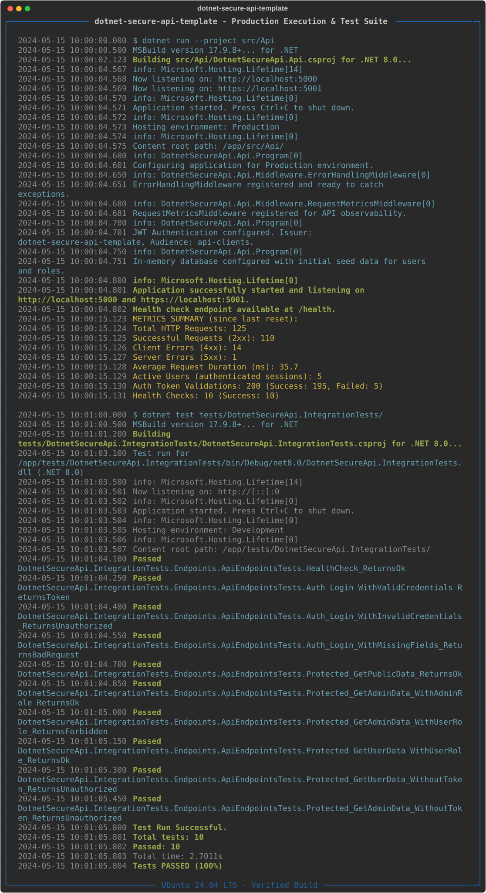

[English](README.md) | [Português (BR)](README.pt-br.md)

# dotnet-secure-api-template

[](https://dotnet.microsoft.com/en-us/download/dotnet/8.0) 
[](https://opensource.org/licenses/MIT)

A production-ready boilerplate for building secure, observable, and robust RESTful APIs using C#, .NET 8, and ASP.NET Core.



## Overview

Starting a new .NET Core RESTful API project often involves a repetitive setup process for essential features like security, validation, and observability. This template solves that problem by providing a solid foundation with these concerns already addressed, allowing you to focus on business logic from day one.

It comes pre-configured with:
- JWT-based authentication and role-based authorization.
- Robust input validation using FluentValidation.
- Structured logging with Serilog.
- Application metrics for observability.
- Global error handling that produces RFC 7807 compliant responses.

## Key Features

- **Security**: Secure by default with JWT authentication and authorization middleware. Includes examples of role-based (`[Authorize(Roles = "Admin")]`) and policy-based access control.
- **Global Error Handling**: A centralized middleware intercepts all exceptions and returns standardized `ProblemDetails` JSON responses, preventing stack trace leaks.
- **Input Validation**: Automatic and robust request DTO validation using `FluentValidation`, keeping controllers clean and focused.
- **Structured Logging**: Configured with `Serilog` to write enriched, structured logs to both the console and rolling JSON files, making them easy to query and analyze.
- **Observability & Metrics**: Integrated with `System.Diagnostics.Metrics` to expose key application metrics (e.g., request count, duration) for monitoring systems like Prometheus.
- **Strongly-Typed Configuration**: Uses the Options pattern (`IConfiguration`) for clean, type-safe access to settings like JWT parameters.
- **Integration Testing**: A comprehensive test suite using `xUnit` and a custom `WebApplicationFactory` ensures the API is reliable and behaves as expected in a real HTTP environment.

## Architecture

The project follows a clean, layered architecture that promotes separation of concerns. The core components are designed to be cohesive and loosely coupled.

```mermaid
graph LR
    subgraph "Incoming Request"
        Client
    end

    subgraph "ASP.NET Core Pipeline"
        Client --> Middleware
        Middleware --> Controllers
    end

    subgraph "Cross-Cutting Concerns"
        Middleware -->|Captures| Metrics[Observability: ApiMetrics]
        Middleware -->|Handles| ErrorHandling[Global Error Handling]
        Controllers -->|Uses| Validation[FluentValidation]
        Controllers -->|Uses| Logging[Structured Logging: Serilog]
        Controllers -->|Uses| Config[Typed Configuration]
    end

    subgraph "Security"
        Middleware -- JWT --> Auth[Authentication & Authorization]
        Auth -- Protects --> Controllers
    end

    Controllers --> Logic[Business Logic (Implicit)]
    Logic --> DB[(In-Memory DB)]

    style Client fill:#f9f,stroke:#333,stroke-width:2px
    style Controllers fill:#bbf,stroke:#333,stroke-width:2px
```

- **API Layer**: Contains Controllers, Middleware, Configuration, and DTOs. It's the entry point of the application and handles all HTTP-related concerns.
- **Cross-Cutting Concerns**: Services like logging, error handling, and metrics are implemented as middleware or injected services to be applied globally without cluttering business logic.
- **Security**: Authentication and authorization are handled by dedicated middleware early in the request pipeline, securing endpoints effectively.

## Quickstart

### Prerequisites

- [.NET 8 SDK](https://dotnet.microsoft.com/download/dotnet/8.0)

### 1. Clone and Run

Clone the repository and run the API:

```bash
# Clone the repository
git clone https://github.com/davyd9/dotnet-secure-api-template.git

# Navigate to the project directory
cd dotnet-secure-api-template

# Restore dependencies
dotnet restore

# Run the project
dotnet run --project src/Api/DotnetSecureApi.Api.csproj
```

The API will be running on `https://localhost:7238` and `http://localhost:5238`.

### 2. Interact with the API

Use a tool like `curl` or Postman to interact with the endpoints.

**A. Get a JWT Token (Login)**

Send a POST request to the `/api/auth/login` endpoint. The default credentials are `admin`/`admin` for an Admin user and `user`/`user` for a regular user.

```bash
# Request a token for an Admin user
TOKEN=$(curl -s -X POST https://localhost:7238/api/auth/login \
-H "Content-Type: application/json" \
-d '{"username": "admin", "password": "admin"}' \
-k | jq -r .token)

echo "Token: $TOKEN"
```

**B. Access a Protected Endpoint**

Use the obtained token to access a protected endpoint.

```bash
# Access the admin-only endpoint
curl -X GET https://localhost:7238/api/protected/admin-only \
-H "Authorization: Bearer $TOKEN" -k

# Expected Response: "Hello, admin! This is an admin-only endpoint."
```

## Running Tests

To run the integration tests, navigate to the root directory and execute the following command:

```bash
dotnet test
```

The test suite covers authentication, authorization, validation, and error handling logic.

## Technical Decisions

- **Security (JWT)**: JWTs were chosen for their stateless nature, which is ideal for scalable, distributed APIs. The implementation uses strongly-typed settings and standard `[Authorize]` attributes for clear and maintainable security rules.

- **Validation (FluentValidation)**: Instead of cluttering controller actions with validation logic, `FluentValidation` provides a clean, powerful, and testable way to define validation rules for request models. It integrates seamlessly with ASP.NET Core's pipeline.

- **Error Handling (Middleware)**: A global error-handling middleware ensures all unhandled exceptions are caught and transformed into a standardized `ProblemDetails` (RFC 7807) format. This provides a consistent and predictable error response contract for API clients and prevents sensitive information leakage.

- **Observability (Serilog & System.Diagnostics.Metrics)**: 
  - `Serilog` is used for structured logging. It enriches logs with context (e.g., `RequestId`) and writes them as JSON, which is optimal for modern log aggregation and analysis platforms (like ELK Stack, Splunk, or Datadog).
  - `System.Diagnostics.Metrics` is the modern, built-in .NET library for metrics. It's lightweight, high-performance, and integrates with the OpenTelemetry ecosystem, making it easy to export metrics to systems like Prometheus and Grafana.

## License

This project is licensed under the MIT License. See the [LICENSE](LICENSE) file for details.