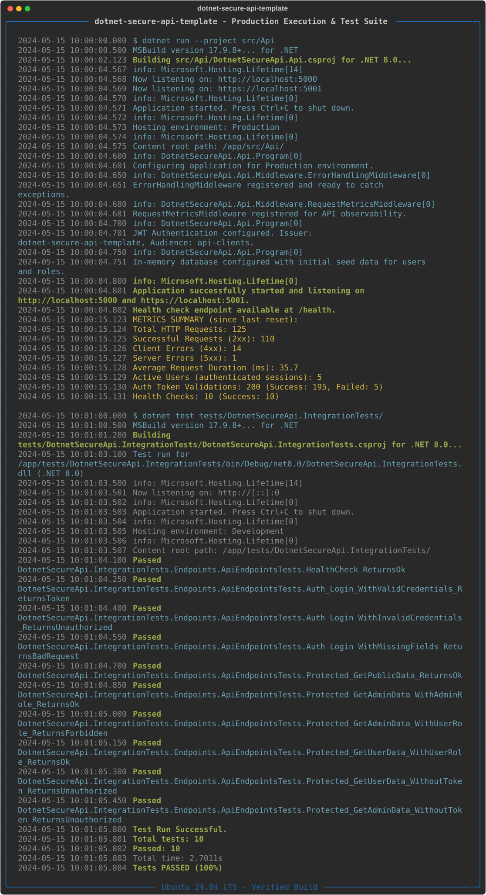

[English](README.md) | [Português (BR)](README.pt-br.md)

# dotnet-secure-api-template

[](https://dotnet.microsoft.com/en-us/download/dotnet/8.0) 
[](https://opensource.org/licenses/MIT)

Um boilerplate pronto para produção para construir APIs RESTful seguras, observáveis e robustas usando C#, .NET 8 e ASP.NET Core.



## Visão Geral

Iniciar um novo projeto de API RESTful em .NET Core frequentemente envolve um processo de configuração repetitivo para funcionalidades essenciais como segurança, validação e observabilidade. Este template resolve esse problema fornecendo uma base sólida com essas preocupações já resolvidas, permitindo que você foque na lógica de negócio desde o primeiro dia.

Ele vem pré-configurado com:
- Autenticação baseada em JWT e autorização baseada em roles.
- Validação de entrada robusta usando FluentValidation.
- Logging estruturado com Serilog.
- Métricas de aplicação para observabilidade.
- Tratamento de erros global que produz respostas compatíveis com RFC 7807.

## Funcionalidades Principais

- **Segurança**: Seguro por padrão com autenticação JWT e middleware de autorização. Inclui exemplos de controle de acesso baseado em roles (`[Authorize(Roles = "Admin")]`) e policies.
- **Tratamento Global de Erros**: Um middleware centralizado intercepta todas as exceções e retorna respostas JSON padronizadas `ProblemDetails`, prevenindo o vazamento de stack traces.
- **Validação de Entrada**: Validação de DTOs de requisição automática e robusta usando `FluentValidation`, mantendo os controllers limpos e focados.
- **Logging Estruturado**: Configurado com `Serilog` para escrever logs estruturados e enriquecidos tanto no console quanto em arquivos JSON rotativos, tornando-os fáceis de consultar e analisar.
- **Observabilidade & Métricas**: Integrado com `System.Diagnostics.Metrics` para expor métricas chave da aplicação (ex: contagem de requisições, duração) para sistemas de monitoramento como o Prometheus.
- **Configuração Fortemente Tipada**: Usa o padrão Options (`IConfiguration`) para acesso limpo e seguro a tipos de configurações, como os parâmetros JWT.
- **Testes de Integração**: Uma suíte de testes abrangente usando `xUnit` e uma `WebApplicationFactory` customizada garante que a API é confiável e se comporta como esperado em um ambiente HTTP real.

## Arquitetura

O projeto segue uma arquitetura limpa e em camadas que promove a separação de responsabilidades. Os componentes principais são projetados para serem coesos e fracamente acoplados.

```mermaid
graph LR
    subgraph "Requisição de Entrada"
        Client
    end

    subgraph "Pipeline do ASP.NET Core"
        Client --> Middleware
        Middleware --> Controllers
    end

    subgraph "Interesses Transversais (Cross-Cutting Concerns)"
        Middleware -->|Captura| Metrics[Observabilidade: ApiMetrics]
        Middleware -->|Trata| ErrorHandling[Tratamento Global de Erros]
        Controllers -->|Usa| Validation[FluentValidation]
        Controllers -->|Usa| Logging[Logging Estruturado: Serilog]
        Controllers -->|Usa| Config[Configuração Tipada]
    end

    subgraph "Segurança"
        Middleware -- JWT --> Auth[Autenticação & Autorização]
        Auth -- Protege --> Controllers
    end

    Controllers --> Logic[Lógica de Negócio (Implícita)]
    Logic --> DB[(Banco de Dados em Memória)]

    style Client fill:#f9f,stroke:#333,stroke-width:2px
    style Controllers fill:#bbf,stroke:#333,stroke-width:2px
```

- **Camada de API**: Contém Controllers, Middleware, Configurações e DTOs. É o ponto de entrada da aplicação e lida com todas as preocupações relacionadas ao HTTP.
- **Interesses Transversais**: Serviços como logging, tratamento de erros e métricas são implementados como middleware ou serviços injetados para serem aplicados globalmente sem poluir a lógica de negócio.
- **Segurança**: Autenticação e autorização são tratadas por middlewares dedicados no início do pipeline da requisição, protegendo os endpoints de forma eficaz.

## Guia Rápido

### Pré-requisitos

- [.NET 8 SDK](https://dotnet.microsoft.com/download/dotnet/8.0)

### 1. Clone e Execute

Clone o repositório e execute a API:

```bash
# Clone o repositório
git clone https://github.com/davyd9/dotnet-secure-api-template.git

# Navegue para o diretório do projeto
cd dotnet-secure-api-template

# Restaure as dependências
dotnet restore

# Execute o projeto
dotnet run --project src/Api/DotnetSecureApi.Api.csproj
```

A API estará rodando em `https://localhost:7238` e `http://localhost:5238`.

### 2. Interaja com a API

Use uma ferramenta como `curl` ou Postman para interagir com os endpoints.

**A. Obtenha um Token JWT (Login)**

Envie uma requisição POST para o endpoint `/api/auth/login`. As credenciais padrão são `admin`/`admin` para um usuário Admin e `user`/`user` para um usuário regular.

```bash
# Requisite um token para um usuário Admin
TOKEN=$(curl -s -X POST https://localhost:7238/api/auth/login \
-H "Content-Type: application/json" \
-d '{"username": "admin", "password": "admin"}' \
-k | jq -r .token)

echo "Token: $TOKEN"
```

**B. Acesse um Endpoint Protegido**

Use o token obtido para acessar um endpoint protegido.

```bash
# Acesse o endpoint exclusivo para admins
curl -X GET https://localhost:7238/api/protected/admin-only \
-H "Authorization: Bearer $TOKEN" -k

# Resposta Esperada: "Hello, admin! This is an admin-only endpoint."
```

## Executando Testes

Para executar os testes de integração, navegue para o diretório raiz e execute o seguinte comando:

```bash
dotnet test
```

A suíte de testes cobre a lógica de autenticação, autorização, validação e tratamento de erros.

## Decisões Técnicas

- **Segurança (JWT)**: JWTs foram escolhidos por sua natureza stateless, que é ideal para APIs escaláveis e distribuídas. A implementação usa configurações fortemente tipadas e atributos `[Authorize]` padrão para regras de segurança claras e de fácil manutenção.

- **Validação (FluentValidation)**: Em vez de poluir as actions dos controllers com lógica de validação, o `FluentValidation` fornece uma maneira limpa, poderosa e testável de definir regras de validação para modelos de requisição. Ele se integra perfeitamente ao pipeline do ASP.NET Core.

- **Tratamento de Erros (Middleware)**: Um middleware global de tratamento de erros garante que todas as exceções não tratadas sejam capturadas e transformadas em um formato padronizado `ProblemDetails` (RFC 7807). Isso fornece um contrato de resposta de erro consistente e previsível para os clientes da API e previne o vazamento de informações sensíveis.

- **Observabilidade (Serilog & System.Diagnostics.Metrics)**: 
  - `Serilog` é usado para logging estruturado. Ele enriquece os logs com contexto (ex: `RequestId`) e os escreve como JSON, o que é ideal para plataformas modernas de agregação e análise de logs (como ELK Stack, Splunk ou Datadog).
  - `System.Diagnostics.Metrics` é a biblioteca moderna e nativa do .NET para métricas. É leve, de alta performance e se integra com o ecossistema OpenTelemetry, facilitando a exportação de métricas para sistemas como Prometheus e Grafana.

## Licença

Este projeto está licenciado sob a Licença MIT. Veja o arquivo [LICENSE](LICENSE) para mais detalhes.